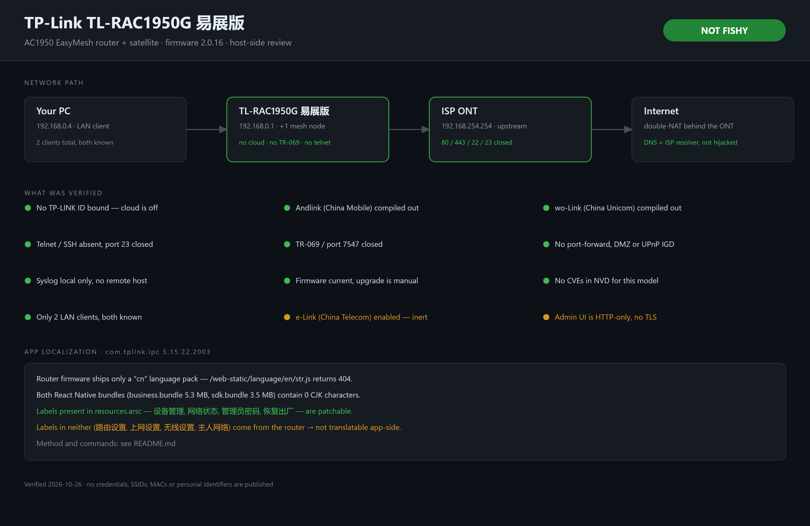

# tl-rac1950g-teardown

Host-side notes on the **TP-Link TL-RAC1950G 易展版** (AC1950 EasyMesh router) and its
Android app **`com.tplink.ipc`** — what the hardware actually does, whether it phones
home, and why its UI cannot be fully translated to English.



> **Short version:** genuine TP-Link hardware, and every remote-access channel this
> firmware supports is either compiled out or switched off. Not fishy. Two ordinary
> weaknesses worth fixing, and one China-carrier feature left enabled.

---

## Why this repo exists

Search results for this model are almost entirely Chinese retail pages. If you bought
one outside China — or you are being handed one by an ISP — there is very little in
English telling you what it does, what it talks to, or how to check it yourself.

Everything here was measured on one retail unit. Every command is included so you can
re-run it on yours and get your own answer instead of trusting mine.

---

## The device

| | |
|---|---|
| Model | TP-Link **TL-RAC1950G 易展版** |
| Class | AC1950 dual-band, EasyMesh ("易展") capable |
| OUI | `68:77:24` → TP-Link Technologies, Shenzhen |
| Firmware | Main **2.0.16**, satellite `_6037` **2.0.12** |
| Admin UI | **factory default `http://192.168.10.1`** (back label) — this unit runs `192.168.0.1` |
| UI framework | TP-Link China `dynaform` |
| Web server | **HTTP only**, on TCP **80** and TCP **1900** |
| Auth | SCRAM-style PBKDF2-SHA256, 1000 iterations |
| Language packs | **`cn` only** |

The unit under test ran as a router behind an ISP ONT, so it was double-NAT'd
(`192.168.0.1/24` → WAN `192.168.254.131/24`, gateway `192.168.254.254`).

---

## What was checked, and how

### 1. Is it real hardware?

```bash
curl -s https://api.macvendors.com/68:77:24     # -> TP-LINK TECHNOLOGIES CO.,LTD.
curl -s -I http://192.168.0.1/                  # -> 405 on HEAD, charset=UTF-8
curl -s http://192.168.0.1/ | grep -o 'proName="[^"]*"'
# -> proName="TL-RAC1950G易展版"
```

The web root leaks the internal model name before login. A clone would not match both
the OUI and the firmware's own product string.

### 2. What is listening?

```bash
# TCP sweep of the usual suspects
for p in 22 23 53 80 443 1900 5000 7547 8080 8443 8888 20005; do
  timeout 1 bash -c "</dev/tcp/192.168.0.1/$p" 2>/dev/null && echo "OPEN $p"
done
# -> OPEN 80, OPEN 1900
```

Only two TCP ports. **1900 is not a second service** — it is the same web server on an
alternate port, returning byte-identical headers:

```
HTTP/1.0 404 Not Found
Content-Type: text/html;charset=UTF-8
Content-Length: 0
Connection: close
Cache-control: no-cache
```

Critically, **7547 (TR-069) is closed**. That is the port ISPs use to reconfigure a
router remotely, and it is the one that actually matters.

### 3. Is UPnP punching holes?

```bash
# SSDP M-SEARCH on UDP 1900, ST: ssdp:all
# -> zero responses, no InternetGatewayDevice
```

Nothing advertises an IGD, and this firmware's web UI has **no port-forwarding, DMZ, or
UPnP page at all**. There is no supported way to expose a LAN service through it.

### 4. Does it phone home?

The firmware exposes its own capability flags to the web UI as JavaScript globals.
Reading them is more reliable than reading the rendered menus, because a `false` flag
means the code was compiled out, not merely hidden:

```js
// paste into the admin page console after login
JSON.stringify({
  gCloudAccountBR: gCloudAccountBR.account,   // ""  -> no TP-LINK ID bound
  gAndlinkSupport: gAndlinkSupport,           // false
  gWoLinkSupport: gWoLinkSupport,             // false
  gElinkSupport: gElinkSupport,               // true  <-- see below
  gMeshSupport: gMeshSupport,                 // true
  gIpv6Support: gIpv6Support                  // true
})
```

Confirmed by other means:

| Channel | Result |
|---|---|
| TP-LINK ID / cloud management | **not bound** (`account` is empty) |
| Andlink (China Mobile) | **compiled out** — no menu entry exists |
| wo-Link (China Unicom) | **compiled out** |
| Telnet | **compiled out**, and port 23 closed |
| SSH | absent, port 22 closed |
| TR-069 / 7547 | closed |
| TP-Link cloud tunnel / 20005 | closed |
| Remote syslog | **none configured** — local ring buffer only |
| Firmware auto-update | **none** — upgrade is a manual button press |
| Known CVEs (NVD) | **none** for this model |

The syslog page contained nothing but DHCP lease noise over ~4 days of uptime.

### 5. Is DNS being hijacked?

The WAN-configured resolver was checked against APNIC RDAP and resolved to the **ISP's
own registered network**, not to a third party or a resolver in China. The router was
not overriding DNS.

### 6. What is on the LAN?

Two clients, both accounted for. Nothing unexpected had ever associated.

---

## Findings

### Clean

- Genuine TP-Link hardware and firmware — not a relabelled clone.
- No cloud account bound, so no vendor-side remote management path exists.
- Andlink and wo-Link are **absent from the build**, not merely disabled.
- No telnet, no SSH, no TR-069.
- No port forwarding, no DMZ, no UPnP IGD.
- No remote logging, no auto-update.
- No published CVEs for this model.
- DNS untouched.

### Worth fixing

1. **The admin password was `Admin!`.** Trivially guessable and the first thing any
   scanner tries. Change it.
2. **The admin UI is HTTP only.** There is no TLS listener at all, so the password
   crosses the LAN in cleartext on every login.
3. **`e-Link` (China Telecom) is enabled.** See below.

### The one China-carrier feature left on

`gElinkSupport` is `true`, and the **e-Link设置** page ships with
*"启用与智能网关的无线配置同步"* **checked**. Per the page's own help text, when the
router is connected to a compatible smart gateway it will sync wireless configuration
and drop into bridge mode — after which rate limiting, access schedules, domain
blocking and IP/MAC binding all stop working.

Behind a normal ISP ONT this never fires, so it is inert in practice. But it buys
nothing outside a China Telecom deployment and it is one upstream device away from
reconfiguring your network. **Turn it off** under 路由设置 → e-Link设置.

> Andlink and wo-Link are the equivalent features for China Mobile and China Unicom.
> Both are compiled out of this build, so there is nothing to disable.

---

## The app, and the English translation question

**`com.tplink.ipc` v5.15.22.2003**, 172 MB, target SDK 30.

The claim that "the settings page can't be translated because the text comes from the
router" is **half right**. It is worth separating the two halves, because one of them
is patchable and the other is not.

### How the app is built

```
base.apk  (172 MB, 8819 entries)
├── assets/plugins/AB739671AE5E56A529_v1.16.13.1060-master.bin   (3.0 MB)
│     └── ZIP @ offset 176 → 326 entries
│           ├── business.bundle    (5,260,747 B)  Metro React Native bundle
│           └── drawable-*/projects_tplinkrnsdkrouter_*   ← the router UI itself
├── assets/rn_sdk/sdk.bundle       (3,526,673 B)  plain JS
├── assets/pluginMarket/dist.zip   (Vue app: index.html, app.js, chunk-vendors.js)
└── resources.arsc                 (4,047,564 B)
```

Two things fall out of this immediately:

- The plugin `.bin` is **not a binary blob** — it is a ZIP whose header starts at byte
  176. Everything inside is readable.
- `business.bundle` is a **plain Metro bundle**, not Hermes bytecode
  (`__d(function(g,r,i,a,m,e,d){…`), so it is ordinary JavaScript.

### The decisive measurement

Scanning both React Native bundles for CJK characters returns **zero**:

| File | Size | CJK characters |
|---|---|---|
| `business.bundle` | 5,260,747 B | **0** |
| `sdk.bundle` | 3,526,673 B | **0** |

The scanner is not broken — the same pass finds `router` 4,418 times and `http` 187
times in `business.bundle`. The bundles genuinely contain no Chinese text.

So the app's UI code holds **no user-visible Chinese at all**. Every label it renders
must be resolved at runtime, from one of two places: Android string resources, or the
router itself.

### Which labels live where

| Label | `resources.arsc` | RN bundles | Verdict |
|---|---|---|---|
| 设备管理 | **present** (×2) | 0 | patchable |
| 网络状态 | **present** (×6) | 0 | patchable |
| 管理员密码 | **present** (×1) | 0 | patchable |
| 恢复出厂 | **present** (×33) | 0 | patchable |
| 路由设置 | absent | 0 | router-supplied |
| 上网设置 | absent | 0 | router-supplied |
| 无线设置 | absent | 0 | router-supplied |
| 主人网络 | absent | 0 | router-supplied |

And the router side has no English to offer:

```bash
for l in cn en us zh_CN en_US default; do
  curl -s -o /dev/null -w "$l -> %{http_code} %{size_download}\n" \
    "http://192.168.0.1/web-static/language/$l/str.js"
done
# cn -> 200 84754
# en -> 404 0
# us -> 404 0
# zh_CN -> 404 0
# en_US -> 404 0
# default -> 404 0
```

The web UI hardcodes its language path in `class.js`:

```js
{tag:"script",url:"../web-static/language/cn/str.js"}
```

There is exactly one language pack on the device, and it is Chinese. This is a
China-market SKU; no international firmware branch exists for it.

### The correction: the app already ships a full English translation

The obvious next question is "then where is the English?" It is already in the APK.
Comparing the two resource sets settles it:

| Resource set | Strings | Containing CJK |
|---|---|---|
| `res/values/` (default) | 10,464 | **8,968** |
| `res/values-en/` | 8,969 | **0** |

Every one of the 8,967 CJK strings in the default set has an English counterpart, and
**all 8,967 differ from the Chinese** — none are copy-paste placeholders. Examples:

| Resource | Chinese (default) | English (`values-en`) |
|---|---|---|
| `LAN_video_all_channel` | 所有通道 | All channels |
| `LAN_video_cancel_download` | 取消下载 | Cancel |
| `LAN_video_download_leave_hours` | `%1$d小时%2$d分钟` | `%1$d h %2$d min` |
| `LAN_video_download_not_leave` | 大约需要%1$s，请勿离开当前页面 | Approximately %1$s is required, please do not leave the current page |

So the app was never untranslated. It has a complete English translation — it just
isn't the **default**. `values/` is Chinese, and `values-en/` is only consulted when
the resolved locale is English. Anything that resolves to something else — a system
language set to Chinese, or a locale the app sets for itself — falls back to the
Chinese default.

### The fix that actually works

Replace the Chinese defaults with their shipped English counterparts. No translation
was invented; the strings were already there.

| What | Count |
|---|---|
| `values/strings.xml` CJK strings swapped for their `values-en` text | 8,967 |
| Strings with no English counterpart, translated by hand | 1 (`app_error` → "App error") |
| Dropdown / survey `<item>` entries across 85 string-arrays | 449 items, 278 unique phrases |
| Library strings in `values-zh/strings.xml` | 2 |

After the patch, `res/values/*.xml` contains **zero CJK characters**. Because the
*default* resource set is now English, it renders English under any locale —
including a forced Chinese one, since `values-zh` then only carries the two library
strings (also translated) and everything else falls back to the English default.

Two details worth knowing if you reproduce it:

- **`week_day` is ambiguous.** `日` means "Day" in `date_unit_list` (年/月/日) but
  "Sunday" in `week_day` (日/一/二/三/四/五/六). A single string→string map gives the
  wrong one; the weekday array has to be fixed separately.
- **Do not touch the `formatted` attributes.** The English text already carries the
  same `%1$d` / `%1$s` placeholders, so swapping only the element body is safe.

### What is still Chinese, and why

Labels that exist in **neither** the bundles nor the resources: 路由设置, 上网设置,
无线设置, 主人网络. They arrive from the router at runtime, and the router only speaks
Chinese. Changing them requires replacing the router's own `str.js` — i.e. firmware
access, which this device does not expose (no telnet, no shell).

So the settings page really is stuck, **but not because "the app can't be translated."**
It is stuck because that specific page's vocabulary is fetched from a device that has
no English dictionary.

> **Caveat, stated plainly:** the router-supplied conclusion is inferred from the
> absence of those strings in every local artifact, not proven by packet capture. If
> you MITM the app's local API and find them in a response, that would confirm it — a
> useful contribution if you have the setup.

### Distribution and scope of the licence

This repository is **private**. Both APKs are attached as private release assets for
personal use on the owner's own device:

- the **official** `com.tplink.ipc` build as pulled from the device, and
- the **English** build produced by the patch above.

Both are TP-Link's proprietary software, and the English build is a derivative of it.
Keeping a copy you already own in private storage is not redistribution — but
**making this repository public with those assets attached would be**, and that is
not something the licence below grants. The MIT licence covers the text, the diagram
and the tooling in this repo only; it does not extend to either APK.

---

## Reproducing the bundle scan

```bash
node tools/scan-bundle.mjs <dir-with-extracted-bundles>
```

See [`tools/scan-bundle.mjs`](tools/scan-bundle.mjs). It reports, per file, the byte
size, the CJK character count, sample CJK runs, and per-keyword hit counts, plus an
ASCII sanity check so a zero can be distinguished from a broken scan.

To get the bundles out of the APK:

```bash
unzip -o base.apk 'assets/plugins/*' 'assets/rn_sdk/*' -d out
python3 - <<'PY'
# the plugin .bin is a ZIP starting at offset 176
data = open('out/assets/plugins/AB739671AE5E56A529_v1.16.13.1060-master.bin','rb').read()
open('plugin.zip','wb').write(data[176:])
PY
unzip -o plugin.zip business.bundle -d out
```

---

## What was *not* verified

Being explicit about the limits of this review:

- **No packet capture on the WAN link.** "No telemetry" here means *no configured
  channel for telemetry exists* — not that zero bytes ever leave the device.
- **No firmware image analysis.** The checks are behavioural and configuration-level.
  A backdoor would not necessarily show up in any of them.
- **"No CVE" is not "no bugs."** This is a China-market SKU with little Western
  advisory coverage. Absence of entries is weak evidence.
- **The app's local API was not intercepted.** See the caveat above.

---

## Privacy

This repo deliberately publishes **no** credentials, SSIDs, MAC addresses, client
hostnames, DHCP leases, or public IPs. LAN addresses shown are RFC1918 and generic.
If you fork this and add your own output, redact before you push.

---

## Disclaimer

Measurements from a single retail unit, 2026-10-26. Firmware changes; re-run the checks
on yours. Nothing here is an accusation against TP-Link — the finding is that this
device behaves like an ordinary consumer router with China-market features compiled
out.

## License

MIT — see [LICENSE](LICENSE).
